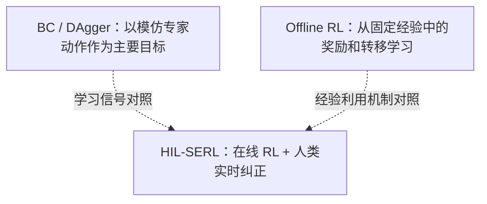

# 论文解读设计原则

> **适用范围**：Suchenl 个人主页的「论文解读（Paper Notes）」独立入口、所有单篇论文解读、深度阅读器、相关研究专题与教学图示。
>
> **确认时间**：2026-10-28。此文为已确认的长期设计契约，完整保留本轮讨论涉及的目标、结构、例子、交互、分工与验收要求；不表示所有能力已经上线。

## 一、为什么需要独立的论文解读专题

论文解读不应该只是给个人主页增加一个栏目，而是要**重新设计一套真正帮助研究者理解论文、积累知识、形成研究判断的阅读体系**。

现有 Research 知识库集合论文、专题综述、技术问答、研究探索、研究计划、术语解释与学习路线，主要问题是这些认知任务在浏览层面容易混在一起。论文解读需要独立浏览入口，但**不能复制一套论文正文仓库**。

核心目标：

> 让一个具有相关技术背景、但没有读过这篇论文的人，在尽可能短的时间里，建立足够准确、深入、可迁移的理解。

必须服务四个层次：

| 理解层次 | 要达到什么程度 | 包含内容 |
|---|---|---|
| 第一层：知道它做了什么 | 建立全貌 | 研究问题、核心思想、一句话贡献 |
| 第二层：理解为什么这么做 | 建立因果解释 | 背景、概念、历史路线、设计动机、方法取舍 |
| 第三层：真正看懂怎么实现 | 可以重述完整流程 | 执行流程、算法、公式、训练与推理、具体实例 |
| 第四层：形成独立研究判断 | 可以评价和迁移 | 实验验证、证据边界、局限性、对比工作、后续问题 |

很多不充分的解读是第二、三层还不够扎实，就开始介绍第四层：能复述作者贡献，却回答不了数据如何进入系统、哪些模块更新、每轮如何流转。

**核心顺序：先让人真正理解，再让人独立判断。** 正文首先像一位优秀的技术老师，将论文机制讲明白；再像研究者那样分析实验、证据、边界与未来问题。不能一上来就要求读者站在审稿人视角。

## 二、阅读组织：三层渐进式阅读、十个核心模块

本模板的思想与 S. Keshav 的《How to Read a Paper》三遍阅读法相通：先了解全貌，再理解内容，最后重建与批判性分析。它是**认知顺序的契约，而不是每篇文章必须写十个相同标题的机械模板**。

### 第一层：快速理解（几分钟内建立全貌）

1. **一句话概括**：解决什么问题、用什么思路、获得什么结果。尽量一句到两句准确回答；不要用空洞的宣传语。
2. **核心概念**：读懂本论文不可缺少的术语、缩写与数学概念；不仅定义，还说明这些概念在论文中的实际作用。
3. **研究脉络**：这篇文章处在整个研究线中的哪个位置，前人做到哪里，文章改变了什么，哪些是继承、哪些是差异。

### 第二层：深入理解（真正掌握方法）

4. **问题与动机**：已有方法为什么不够；作者发现什么瓶颈；具体失败场景是什么；提出该方法的必要性。
5. **方法总览**：优先用一张能够直接理解的系统/流程图说明输入、关键模块、数据流、训练与推理、输出和循环关系。
6. **机制精讲**：按必要的子模块，解释如何实现、公式含义、参数更新、数据去向，并让一个具体例子从头到尾运行一次。

### 第三层：研究判断（理解贡献与证据）

7. **实验与证据**：每一个实验验证哪个具体主张；任务、数据、指标、基线、预算、结果是什么；结果是否真正支持主张。
8. **横向比较**：与最相关工作在优化目标、技术机制、训练信号、计算和数据条件、适用边界上的差异；不要只列论文名。
9. **局限与启发**：严格区分作者承认的局限、读者发现的问题、尚未验证的推论，以及真正可迁移的方法思想。
10. **理解检验与延伸阅读**：用少量关键问题验证能否独立解释；提供参考答案、论文原文、代码、项目主页、复现与延伸阅读入口。

### 不同论文的灵活性

- **方法论文**重点是设计动机、输入输出、训练/推理、机制、公式、消融。
- **Benchmark 论文**重点是所测能力与不测能力、任务类型、数据构造、评价方法、基线、泄漏/偏差、可复现性与适用边界。
- **系统/技术报告**重点是整体系统、各训练阶段、模块职责、训练基础设施、独立贡献与开源边界。
- 三种阅读深度：**文献速记、标准解读、深度精读**。轻量收藏不用强行补几千字，也不能被展示为完成了深度核验。速记仍需原始链接、一句话、必要概念与研究定位。深度精读需要方法、实验、比较和理解检验。
- 三层是读者的阅读顺序，不等于创建三份不同正文。各层与跳转锚点指向同一篇唯一 Markdown。

## 三、核心概念表：不是只展开术语缩写

**每项核心概念至少回答**：概念是什么、通俗理解是什么、在本文中具体有什么作用。需要时增加「容易混淆什么」「与相邻概念差异」「完整术语页面」。

以 HIL-SERL 为例：

| 概念 | 通俗理解 | 在本文中的作用 |
|---|---|---|
| HIL | Human-in-the-Loop，人在必要时参与系统运行 | 人类观察机器人执行，必要时接管纠正 |
| RLPD | Reinforcement Learning with Prior Data，利用已有数据辅助强化学习 | 从示范数据和在线经验学习策略 |
| Replay Buffer | 存储环境交互产生的经验 | 支持反复采样训练 |
| Off-policy RL | 用非当前策略产生的数据学习 | 允许重用旧经验及人工示范 |
| Impedance Control | 用类似弹簧、阻尼器的关系控制机器人与环境的交互 | 在接触任务中提供柔顺的底层运动控制 |

读者点击 RLPD，理应能继续理解它与 SAC、BC、DAgger 的区别。**不要将所有出现过的词都堆进表格**；通常优先挑选 5–8 个真正不可缺少的概念。通用术语定义由 `knowledge/glossary/` 单一维护，论文内解释其具体角色而不是重复建立相互冲突的定义。可在页面中使用锚点、术语链接、折叠解释，不依赖复杂悬浮交互才能读懂。

## 四、研究脉络：论文放回整个知识网络

这是论文解读专题应该形成特色的部分。除回答「作者做了什么」，还要解释：**继承旧路线、修复旧缺陷、使用不同范式，还是提出新的测量角度？**

研究脉络**不等于机械的发表年份时间轴**。应当用问题、机制、研究分歧和证据组织。

以 HIL-SERL 的一个比较维度为例：

上图是**教学性机制比较**，不是宣称有简单线性继承关系。

| 比较维度 | BC / DAgger | HIL-SERL |
|---|---|---|
| 核心优化目标 | 模仿专家动作 | 最大化任务回报 |
| 人工纠正的用途 | 提供动作监督标签 | 提供实际执行的经验转移 |
| 是否需要在线试错 | BC 不需要；DAgger 需要交互采集 | 需要 |
| 是否可以超越专家动作 | 可以泛化，但不直接优化任务奖励 | 可以利用 RL 学习更高回报的行为 |

论文要与技术综述、术语、研究问题建立**双向导航**。读论文能返回研究路线，从研究路线能找到代表性论文；连接的是研究问题和实质机制，不是表面词语相似性。知识逐渐成为网络，而不是孤立的文章。关联必须有真实依据，不能把“相关”写成“继承”或“证明”。

## 五、方法精讲：具体例子和过程解释是刚性要求

**不能只放一张漂亮框架图，然后逐项介绍模块。** 先选择最简单、最具体、能够体现论文机制的案例，让读者跟随数据跑完完整流程。

HIL-SERL 的例子：

1. **机器人执行动作**：策略尝试插入物体，但对准出现偏差。
2. **人类接管纠正**：实际执行人类给出的动作，环境产生新的状态与奖励。
3. **记录到经验池**：纠正形成的状态转移进入相应 Buffer，后续训练可以重复采样。
4. **RLPD 更新策略**：Learner 重用示范和在线经验，通过价值学习与策略优化更新参数。
5. **执行更新后的策略**：机器人再次交互并产生经验，形成训练闭环。

之后回答这些容易被忽略的机制问题：为什么两个 Buffer 而不是一个？为什么用 RLPD 不直接 BC？人类纠正的是动作、奖励还是价值函数？Actor 和 Learner 如何通信、何时更新？

每个关键模块优先采用四步讲解：**为什么需要 → 如何实现 → 举例运行 → 去掉它会怎样**。最后一步连接到消融实验，而不是凭直觉断言组件一定有用。

**公式写作规范**：先解释直觉，再解释每个符号和张量含义，再代入简化数值或微型示例，最后说清楚训练哪一个参数及其信息来自哪里。准确区分论文原式、等价整理式和教学性简化公式。用 `$...$` 与 `$$...$$` 保证 Markdown / KaTeX 能渲染，不发布未编译源码。

**图片规范**：复杂方法优先用一张总览图，再用关键子流程图、状态/数据流图、时间轴和训练-推理对照。原论文图片、重绘 SVG、教学示意、作者自主实验结果分别标明身份和来源。自绘图要保留可编辑源文件，确保文字、箭头、尺度、移动端布局正确；图为了理解，不是装饰，也不是每段都必须画图。

## 六、实验分析：主张—证据对照

每篇深度解读都应有可读的 **Claim–Evidence Matrix（主张—证据对照）**，而不只是罗列榜单。

| 作者想证明什么 | 应寻找什么证据 | 必须注意什么限制 |
|---|---|---|
| 新方法优于旧方法 | 同等条件下的主实验 | 数据、训练预算、推理成本是否一致 |
| 某模块确实有用 | 单独移除该模块的消融 | 有没有其他变量同时改变 |
| 方法能够泛化 | 未见任务或分布外测试 | 是否与训练分布高度相似 |
| 方法具有实际价值 | 成本、延迟、真实部署结果 | 是否只在受控环境中成立 |

尽可能将每项结论连接到原论文对应 Figure、Table、§ 或附录；有页码时标注所依据的具体版本。

必须分开：
- **论文事实 / 作者报告结果**：原论文确实给出的设置和数据。
- **证据能够直接支持的结论**：在披露条件下可推出什么。
- **我的解读 / 推论**：跨论文比较、可能原因或尚未验证的延伸。
- **尚待核验 / 局限**：原文尚未给出什么，或缺少足够证据。

不允许把特定数据集上的成功率推广成开放世界可靠性，也不允许只因同名指标就比较不同论文的百分数。保留任务、模型、预算、数据、指标、采样、基线与测试条件；需要时说明统计不确定性和人为介入成本。

## 七、横向比较与证据边界

横向比较应尽量给出**实际优化对象、输入输出、反馈信号、训练方式、推理执行方式、计算与数据成本、独立贡献、局限、发表与开源状态**。优先比较真正回答同一问题的代表性研究，不为凑数量泛泛堆叠论文。

需要纠正对方法的误会：例如 HIL-SERL 不等于纯行为克隆，也不等于可以不依靠人工训练机器人；SuperMimic 的状态世界模型不等于 RGB 视频生成模型。对照机制、条件和证据，不给未经证实的绝对排名。

若相关研究有不同结论，说明实验设置和定义是否一致；必要时保留争议与待验证问题。给出直接可打开的原论文、代码、官方项目主页，以及准确的发表状态；预印本不得标成已经录用。

## 八、理解检验：验证能否离开原文复述

每篇**深度精读**尾部设置约 3 个关键问题，**答案默认折叠**，避免读者尚未思考便看到答案。由文章已有证据形成答案，不能依靠空泛生成。问题不应只询问术语定义，应检验训练信息流、方法区别和证据边界。例如：

1. 人类接管产生的经验，为什么不能简单视为 BC 的动作标签？  
   **参考答案**：实际执行带来真实环境转移和任务反馈，RLPD 可利用这些数据进行价值学习，而不只复制专家动作。
2. 为什么 Demo Buffer 和 RL Buffer 要同时存在？  
   **参考答案**：控制不同数据来源的采样比例，避免少量有价值的示范或纠正被大量自主数据淹没。
3. 特定任务的高成功率能否证明任意机器人任务都能泛化？  
   **参考答案**：不能，需考虑任务专属训练、观测和控制接口、人工介入、训练成本与未见分布测试。

还应鼓励更深入的自检：关掉论文，自己画出算法流程，并讲清数据来自哪里、哪些参数更新、每项设计有哪些实验支持。**阅读自测、本机浏览记录，不等于本人已读**；系统不能因为 AI 完成解读就自动标记 `read`。

## 九、网站结构与页面设计

### 栏目职责（明确区分）

| 导航栏目 | 职责 |
|---|---|
| 论文成果（Publications） | 本人发表或公开的论文 |
| **论文解读（Paper Notes）** | 其他研究工作和技术报告的独立理解与分析 |
| 研究知识库（Research） | 论文、术语、主题综述、路线、技术问答的总目录与关联网络 |
| 问题与探索（Questions） | 持续关注的开放问题、研究判断与可验证假设 |

论文解读采用**独立的 `/paper-notes/` 浏览入口**，但继续渲染 `knowledge/papers/` 的唯一 Markdown 正文，并保留现有 `/research/papers/.../` 详情 URL 与链接。不能制造双份文章，也不应破坏现有 Research 筛选、论文对比与学习路线。

### 论文解读首页

- 标题与简短定位：“理解方法，连接知识，形成判断”。
- 搜索论文标题、简称、算法、术语及研究问题。
- 用领域分类而非纯年份列表组织，领域来自统一 `domains` taxonomy。
- 用**研究问题/研究路线**介绍代表性文献：例如「从示范学习到真实机器人强化学习」（BC / DAgger → SERL / RLPD → HIL-SERL）和「可微分世界模型与策略学习」（Model-Based RL、BPTT、SuperMimic）。路线是学习组织，不是虚构的论文引用关系。
- 论文条目可以看到一句中文简介、年份/发表状态、所属领域、阅读深度、原文入口；可搜索、排序，移动端不丢信息。
- 可以进入已有论文方法对比页，不重复维护比较字段。
- 已有内容只据实显示；不得把未来计划或未实现交互写成已存在能力。

### 论文阅读页

- **左侧可折叠的随滚动目录**，当前章节清楚高亮；尺寸可读，目录不是固定停在文章最顶端。
- **中间高质量长文正文**：足够字号和行距，公式表格可滚动，教学 SVG 可读。
- **右侧（宽屏可选）相关术语/论文原文/相关工作**，避免三栏过于拥挤；移动端折叠，不丢锚点和正文。
- **三个阅读视图：速览 / 完整解读 / 证据与原文**。只是对**同一份 Markdown 的章节导航、重点定位和呈现方式**进行切换，不生成第二份摘要文章、不从段落顺序盲目猜测完整实验结论。
- 速览应快速跳转一句话、概念、研究位置；完整阅读展示全文；证据视图定位实验、主张证据、局限和来源。
- 自测答案可用原生 `details` 默认折叠；不要用假按钮或纯装饰来冒充有效交互。
- 保留目录、复制链接、字号调整、专注阅读、继续阅读、知识图谱反向关联、学习进度、本机状态以及现有浏览器前进后退语义。
- 原文、图像和研究关联可直接打开；不要让用户反复跳转才能看到必要解释。

### 提升图与表的价值

- 每个图都应帮助回答具体问题；一张总图优先于大量重复模块图。
- 矢量 SVG、清晰配色、适当留白、图例及来源标识；图内文字不小到难以阅读。
- 对论文原图必须标明 Figure/Table 和版本；对自绘概念图明确教学性质。
- 表格以研究问题、关键维度、结论与适用条件为中心，避免全量复制无解释数字。
- 页面中英文必须符合语言模式：中文页面中文解读；若英文版缺少对应内容，不要混入伪翻译。

## 十、文风、研究诚信与维护

- **以作者面向公众的第一人称研究者视角写**，不向站点所有者说“你之前提过”“我们聊天时”。不要把论文解读写成 AI 与用户的私人谈话。
- 先直觉与例子，后术语、公式与细节；读者具备技术背景，但不假设读过该篇论文。
- 一次解释一个明确问题，消除重复铺陈；每段尽可能留下能复述、能查证的核心信息。
- 论文事实、作者分析、未经验证猜想、已验证实验严格区分，不把个人偏好当成作者结论。
- **未公开论文、私人仓库、内部实验和私有计划不得出现在公开论文解读中**。跨项目的研究启发只用可公开、可核验的研究材料写。
- 一篇论文一个 canonical Markdown；`knowledge/topics/` 负责跨论文综述，`knowledge/glossary/` 负责术语权威定义，`knowledge/research/` 负责开放问题和可证伪设想；引用而不是复制。
- 任何机制、关键公式、定量结果、会议状态都要核对原文，并标明核验日期与版本。旧链接保留；新判断不应默默覆盖早期人工结论。
- 保留已设计好的论文图、表与网页排版，**不得未经实际构建与视觉核验就进行大规模重排**。

## 十一、样板与验收顺序

**不要批量重写所有论文之后才发现模板不适合。**

1. **HIL-SERL** 为第一篇样板：覆盖 RLPD、Off-policy、阻抗控制、完整训练闭环、人类实时纠正、公式、实验和十张已有 SVG；验证概念表、完整系统图、研究对比、主张—证据和自测能否连贯解释。
2. **SuperMimic** 验证世界模型、梯度路径与数学机制型论文，不把 RGB 生成与物理状态预测混淆。
3. **MiMo-V2.6** 验证大型系统/技术报告、多阶段训练、数据流、模块独立作用与开源程度的组织。
4. 三类样板都成立，才考虑逐篇整理旧论文；轻量卡片按实际证据逐步扩充。

### 功能验收清单

- [ ] 独立 `/paper-notes/` 入口、领域分类、检索、排序、代表性论文和方法对比入口
- [ ] 论文只有一份正文，Research 原有链接、目录、分类、学习路线、论文对比正常
- [ ] 速览/全文/证据模式**真实可用**；切换后导航到实际章节，不伪造摘要
- [ ] 左侧目录可收展、随滚动定位，当前章节高亮；移动端导航可用
- [ ] 概念表与共享术语可关联、方法图有来源、公式/表格不溢出
- [ ] 样板包含独立主张—证据分析、自测问题与**默认隐藏的答案**
- [ ] 发表与开源状态有来源，私有研究无外泄；作者结论与独立推论分清
- [ ] 知识一致性脚本、Astro build 和桌面/移动端浏览器视觉验证通过

**实施状态以代码和实际构建结果为准。** 已完成的功能在提交记录和验收中列出；未完成的功能保持待办，不使用“已全部上线”之类不准确表述。

## 十二、参考与维护位置

- 单一内容源：`knowledge/papers/`；通用模板：`knowledge/templates/paper-note.md`。
- 术语：`knowledge/glossary/`；专题综述：`knowledge/topics/`；研究探索：`knowledge/research/`。
- 站点：`web/src/pages/paper-notes/`（独立入口）及 `web/src/pages/research/[...slug].astro`（统一正文阅读器）。
- 论文对比：`web/src/pages/research/compare/index.astro`。
- 现有前端架构：`docs/RESEARCH_ARCHITECTURE.md`，全站内容规则：`knowledge/AGENTS.md`、`knowledge/TAXONOMY.md`。
- 阅读方法：S. Keshav, *How to Read a Paper*（参考三遍阅读的认知分层，不把它写成本文模板的唯一来源）。
