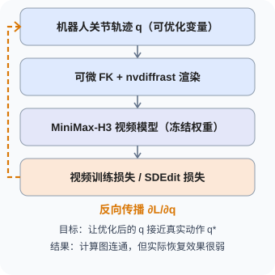
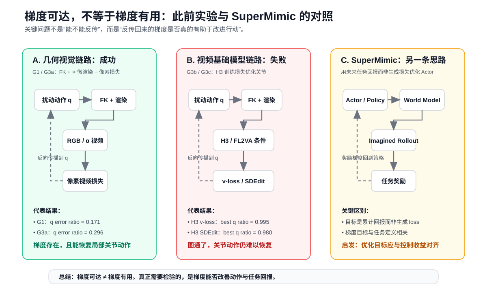
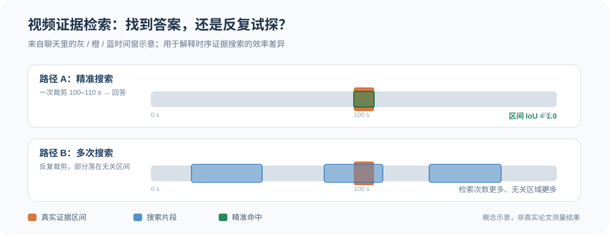
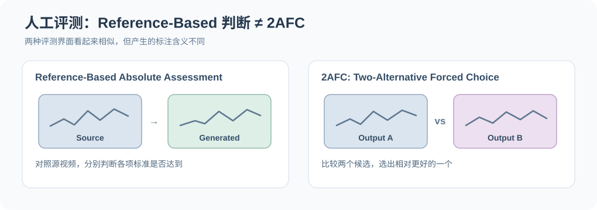

# 研究 SVG 图示索引

这里统一维护已保存到网站仓库的**可编辑 SVG**，包括从研究对话中整理回收的早期构图。图形资产直接保存在 `web/public/research/`，论文正文、研究问题和其他页面按需引用**同一个文件**，不复制图片，不在每次讨论时增加无意义的版本号。

> **来源与证据约定**：这份索引记录图形素材，不是论文实证数据集。标为“对话构图重建”的图根据当时回复中的 SVG 内容/构图重新保存，不能宣称是从聊天界面逐字节导出的原始附件。标为“概念示意”的图不是论文作者的实验结果。涉及未公开工程实现或敏感项目细节的图片不进入公开仓库。

## HIL-SERL：精密机器人 RL（10 张 SVG）

来自 [HIL-SERL 中文全文图解](papers/2024/hil-serl.md)。这批图保留原先解读网页中的 **SVG 矢量源文件**，正文按技术章节穿插展示，机制图为教学示意，数值图遵循指定预印本。SVG 不复制到 Markdown。

| 图形 | 查看 SVG | 状态 |
|---|---|---|
| 系统闭环 | [01_system_overview.svg](../web/public/research/figures/hil-serl/01_system_overview.svg) | 机制示意（不是论文原图） |
| 人工干预与双缓冲 | [02_human_interventions_buffers.svg](../web/public/research/figures/hil-serl/02_human_interventions_buffers.svg) | 机制示意（不是论文原图） |
| 训练准备 | [03_training_setup.svg](../web/public/research/figures/hil-serl/03_training_setup.svg) | 机制示意（不是论文原图） |
| 连续动作与夹爪 | [04_policy_and_gripper.svg](../web/public/research/figures/hil-serl/04_policy_and_gripper.svg) | 机制示意（不是论文原图） |
| 坐标与控制器 | [05_frames_and_low_level_control.svg](../web/public/research/figures/hil-serl/05_frames_and_low_level_control.svg) | 机制示意（不是论文原图） |
| 策略漏斗 Funnel | [06_reliability_funnel.svg](../web/public/research/figures/hil-serl/06_reliability_funnel.svg) | 机制示意（不是论文原图） |
| 反馈与前馈行为 | [07_reactive_vs_predictive.svg](../web/public/research/figures/hil-serl/07_reactive_vs_predictive.svg) | 机制示意（不是论文原图） |
| 任务成功率 | [08_all_tasks_success_rates.svg](../web/public/research/figures/hil-serl/08_all_tasks_success_rates.svg) | 依据预印本 Table 1 的数值重绘 |
| 研究证据边界 | [09_evidence_boundaries.svg](../web/public/research/figures/hil-serl/09_evidence_boundaries.svg) | 机制示意（不是论文原图） |
| 100% 的统计解释 | [10_why_success_not_100pct_truth.svg](../web/public/research/figures/hil-serl/10_why_success_not_100pct_truth.svg) | 补充统计分析（不是论文原图） |

## SuperMimic：方法、实验与梯度效用

| 图形 | 直接查看 SVG | 正文用途 / 状态 |
|---|---|---|
| 可微分世界模型训练闭环 | [training-loop.svg](../web/public/research/supermimic/training-loop.svg) | 正文 §2：Actor / World Model / Critic 的学习循环 |
| 大规模动作追踪失败数 | [failure-counts.svg](../web/public/research/supermimic/failure-counts.svg) | 正文 §3：据原文数字绘制的条形图 |
| World Model 推演速度 | [rollout-speed.svg](../web/public/research/supermimic/rollout-speed.svg) | 正文 §3：论文报告的推演吞吐对照 |
| 视觉与结构化状态的未来策略优化设想 | [visual-policy-proposal.svg](../web/public/research/supermimic/visual-policy-proposal.svg) | 正文 §6：作者研究假设；不是 SuperMimic 已验证方法 |
| 梯度可达性与动作效用对照（正式稿） | [gradient-usefulness.svg](../web/public/research/supermimic/gradient-usefulness.svg) | 正文 §4.4：历史 G3 实验与 SuperMimic 三路径对照 |
| **灰蓝＋橙：视觉梯度反传简图** | [gradient-backprop-sketch.svg](../web/public/research/supermimic/gradient-backprop-sketch.svg) | **对话构图重建；已入正文 §4.4** |
| **早期绿色／红色／琥珀三栏对照** | [gradient-comparison-original.svg](../web/public/research/supermimic/gradient-comparison-original.svg) | **对话构图重建；保存为可编辑备选稿**，正文仍采用正式版以免重复 |

正文入口：[SuperMimic 解读](https://suchenl.github.io/research/papers/2026/supermimic/) · [Markdown 原文](papers/2026/supermimic.md)。

**数值比较边界**：G0/G1/G3a 是像素损失关节恢复实验，G3b/G3c 是冻结 H3 训练损失的局部实验；不同条件、步数和目标不构成等预算性能比较。SuperMimic 是论文作者的 Actor 奖励优化实验，不应把三者的 RMSE 比当成跨系统榜单。

## 其他对话中值得保留的研究图解

| 图形 | 直接查看 SVG | 使用说明 |
|---|---|---|
| 视频证据时间窗：精准检索 vs 多次检索 | [temporal-evidence-search.svg](../web/public/research/figures/temporal-evidence-search.svg) | **对话构图重绘**，保留灰色时间轴、橙色证据、蓝色搜索窗口、绿色命中标识；是说明定位效率的概念示意，不是论文数值 |
| 有源视频绝对判断 vs 2AFC | [reference-assessment-vs-2afc.svg](../web/public/research/figures/reference-assessment-vs-2afc.svg) | **对话构图重绘**，保留灰蓝／绿／紫色卡片，说明两种人工评测标注协议的语义差异 |

这两张图跨越不同研究话题，目前**只在索引中归档，不插入无关的 SuperMimic 论文正文**。以后如出现对应的视频 Agent 阅读条目或人工评测方法论文章，应直接引用现有 SVG，而不是维护第二个副本。

## MiMo-V2.6：Agentic RL 完整论文解读图

以下七张是本次解读中根据先前研究对话的构图重新写成的**原生 SVG**；结构图属于概念复绘，两张结果图仅绘制技术报告所列作者数值。它们不是从聊天 UI 逐字节导出的原始文件，也不是直接复制论文自带插图。

| 图形 | SVG 源文件 | 用途 |
|---|---|---|
| Agentic RL 三维 Scaling | [scaling.svg](../web/public/research/figures/mimo-v2-6/scaling.svg) | 训练计算 × 环境 × Grader |
| 完整训练阶段 | [training-stages.svg](../web/public/research/figures/mimo-v2-6/training-stages.svg) | Pre-training / Mid-training / SFT / RL / MOPD2 |
| 1,568 × 16 的 GRPO Rollout | [rollout.svg](../web/public/research/figures/mimo-v2-6/rollout.svg) | 一轮训练的 Agent ↔ Env 循环 |
| Groupwise Grading | [grading.svg](../web/public/research/figures/mimo-v2-6/grading.svg) | Binary Reward 不足与 Advantage 重新分配 |
| 轨迹四层组织 | [trace-hierarchy.svg](../web/public/research/figures/mimo-v2-6/trace-hierarchy.svg) | Sample / Sequence / Context / Segment |
| DeepSWE RL 前后 | [deep-swe.svg](../web/public/research/figures/mimo-v2-6/deep-swe.svg) | 作者报告的两模型分数 |
| 9B SFT/RL 对比 | [distill-9b.svg](../web/public/research/figures/mimo-v2-6/distill-9b.svg) | 作者报告的四项指标 |

全文：[MiMo-V2.6 深度解读](papers/2026/mimo-mopd2.md) · [站点阅读页](https://suchenl.github.io/research/papers/2026/mimo-mopd2/)。

## 维护方式

- SVG 必须是独立的矢量元素与文字，不要把整张截图塞进 SVG 外壳冒充可编辑图。
- 每张图明确区分原论文数据复绘、概念示意与研究设想；图片 ALT 文本和旁边段落也应该尊重这一边界。
- 在文章中优先使用最有解释力的一张图；其他历史草稿保存在图示索引，避免为了保留素材而牺牲正文阅读体验。
- 原图发生内容更正时更新 canonical 文件和本索引；必要时更新论文引用与网站构建检查。
