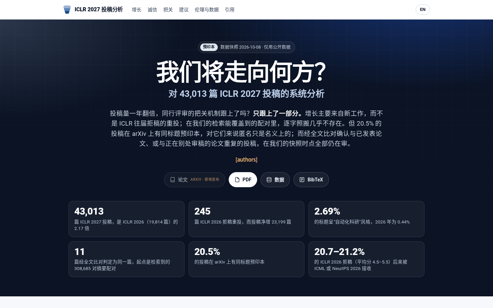

ICLR 2027 收到了 43,013 篇投稿，是 ICLR 2026（19,814 篇）的 2.17 倍。投稿量一年翻倍，审稿人不可能跟着翻倍，于是我想用投稿期就能公开看到的数据回答一个问题：**同行评审的把关机制还跟得上吗？**

我的答案是：只跟上了一部分。完整的交互图表、中英文版本和汇总数据都在项目页：

**👉 [suchenl.github.io/iclr2027](/iclr2027/)**

三点最主要的发现：

1. **增长主要来自新工作，而不是拒稿重投。** 能和 ICLR 2026 拒稿对上的重投只有 245 篇，而投稿净增了 23,199 篇。标题呈"自动化科研"风格的投稿占 2.69%，2026 年是 0.44%；这是总体层面的信号，不能拿来判断任何一篇论文。
2. **逐字照搬几乎不存在，但真重复的都还在审。** 从 308,685 对摘要相似的候选里，经全文比对判定为同一篇论文的只有 11 篇。其中确认与已发表、或正在别处审稿的论文重复的，在数据快照时点全部仍在审。
3. **匿名和拒稿的约束力都打了折扣。** 20.5% 的投稿在 arXiv 上有同标题预印本，对这部分论文来说双盲只是名义上的；ICLR 2026 平均分 4.5–5.5 的拒稿里，有 20.7–21.2% 后来被 ICML 或 NeurIPS 2026 接收。后者不是审稿随机性的度量，因为论文在两次投稿之间可能已经改过。

几点说明：

- 所有分析只用公开数据。我本人是 ICLR 2027 审稿人，但没有使用任何只有审稿人、领域主席或程序主席才能看到的信息。
- 结果只报告汇总，不点名任何投稿。自动信号给出的是线索，不是结论。
- PDF 层面的分析（隐藏文字、提示注入、无法解析的参考文献）还在进行中，项目页上这部分标注为初步结果。论文会发到 arXiv，发布后链接会补到项目页上。
